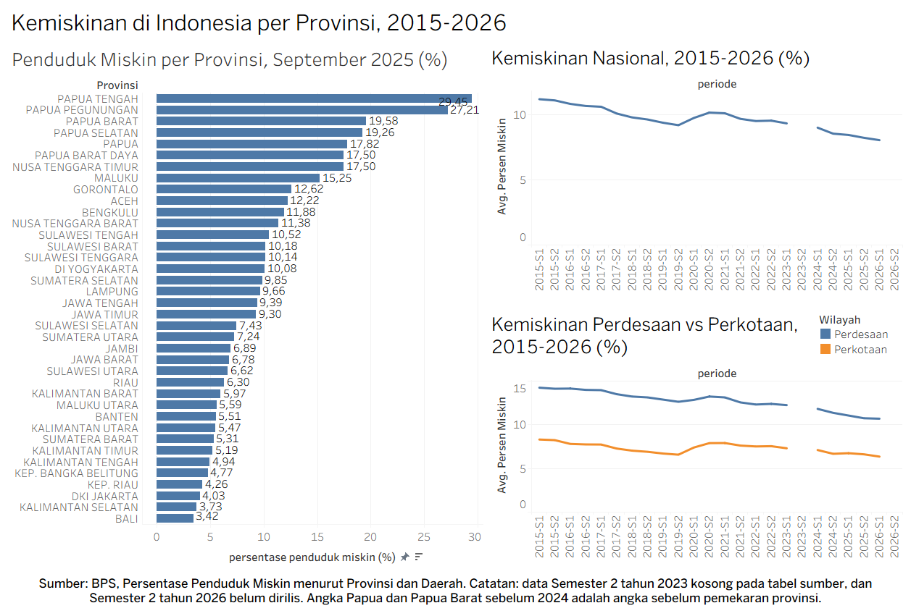

# Analisis Kemiskinan Indonesia per Provinsi (2015-2026)

Proyek latihan analisis data: membersihkan data kemiskinan dari BPS dengan Python, menganalisisnya dengan SQL (MySQL), dan memvisualisasikannya dalam dashboard Tableau.

## Pertanyaan yang dijawab
1. Provinsi mana yang persentase penduduk miskinnya tertinggi pada September 2025?
2. Bagaimana tren kemiskinan nasional, dan seberapa besar dampak pandemi 2020?
3. Apakah selisih kemiskinan perdesaan dan perkotaan menyempit?
4. Provinsi mana yang paling terpukul pandemi, dan mana yang pada 2024 belum kembali ke level sebelum pandemi?

## Data dan alur kerja
**Sumber:** BPS, tabel "Persentase Penduduk Miskin (P0) Menurut Provinsi dan Daerah" (Perkotaan, Perdesaan, dan Jumlah; per semester, 2015-2026).

1. **Pembersihan data (Python/pandas, Google Colab):** [`clear_data.ipynb`](clear_data.ipynb)
   - Header bertingkat diratakan menjadi tabel panjang: `provinsi, wilayah, tahun, semester, persen_miskin` (2.808 baris).
   - Kolom "Tahunan" yang kosong dan baris catatan dibuang.
   - Nilai "-" dan nilai 0 pada DKI Jakarta perdesaan (yang tidak punya wilayah perdesaan) dijadikan NULL.
   - Data yang memang belum tersedia (460 nilai) dibiarkan kosong, tidak diisi atau diperkirakan.
2. **Analisis (SQL, MySQL via Laragon dan HeidiSQL):** [`sql/kemiskinan.sql`](sql/kemiskinan.sql)
   - Berisi pembuatan tabel, pemeriksaan data, dan lima query analisis.
3. **Visualisasi (Tableau):** [`tableau/dashboard_kemiskinan_paket.twbx`](tableau/dashboard_kemiskinan_paket.twbx)
   - Tiga grafik: peringkat provinsi, tren nasional, dan perbandingan perdesaan vs perkotaan.

Data bersih tersedia di [`data/kemiskinan_provinsi.csv`](data/kemiskinan_provinsi.csv).
